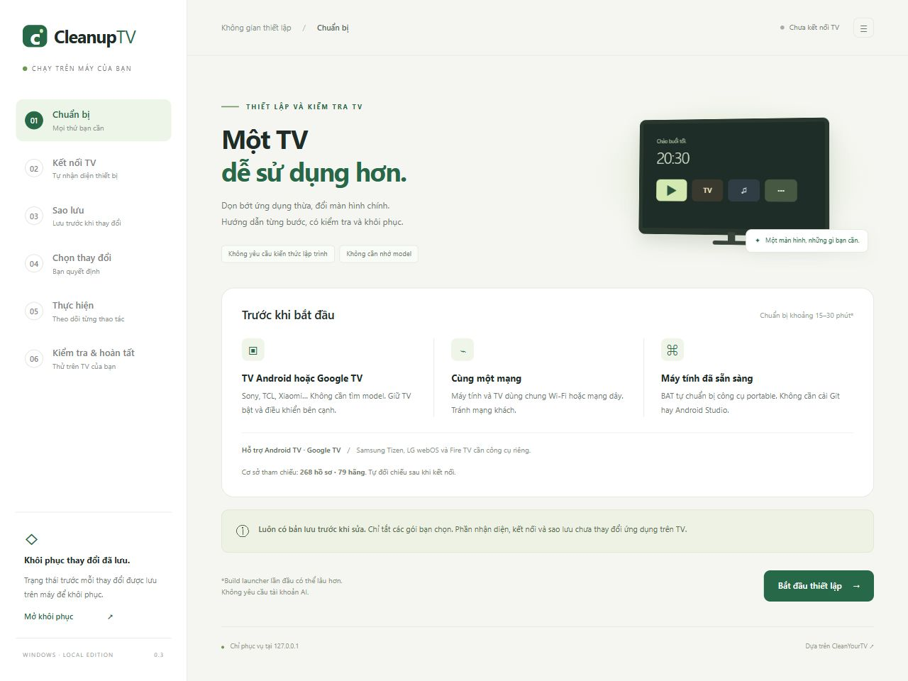

# CleanupTV

Ứng dụng tiếng Việt chạy trên máy tính Windows, hướng dẫn kết nối, kiểm tra tài nguyên, giảm một số dịch vụ không cần thiết và thử màn hình chính [CleanYourTV](https://github.com/Gathin23/cleanyourtv) trên Android TV / Google TV.

**Bản 0.3.0 là bản thử nghiệm. Chưa được xác minh trên TV thật.** Các kiểm thử tự động dùng thiết bị mô phỏng. Cơ sở hồ sơ cộng đồng giúp đối chiếu, không phải chứng nhận tương thích hay bảo đảm TV không gặp lỗi.



**Không cần nhớ model TV, không cần cài Git, Python hay Android Studio.** Ứng dụng tự đọc hãng, model, Android và firmware sau khi kết nối. Không cần tài khoản AI.

## Dùng trên Windows

1. Tải ZIP từ GitHub, chọn **Extract All / Giải nén tất cả** vào thư mục bạn có quyền ghi. Không chạy BAT từ bên trong ZIP.
2. Nhấp đúp **START.bat**. Lần đầu cần Internet để tải Python và ADB portable từ nguồn chính thức, có kiểm tra SHA256. Không cần quyền Administrator.
3. Giữ cửa sổ BAT mở. Trình duyệt tự mở ứng dụng tại địa chỉ `http://127.0.0.1:<cổng>`; cổng được chọn tự động.
4. Làm theo 6 bước: **Chuẩn bị → Kết nối → Sao lưu → Chọn thay đổi → Thực hiện → Kiểm tra**.
5. Xong việc, tắt các tùy chọn gỡ lỗi trên TV theo hướng dẫn. Đóng cửa sổ BAT hoặc Ctrl+C để dừng ứng dụng trên máy.

Lấy bản tải về bằng **Code → Download ZIP** trên trang GitHub của kho này. Lưu ý: phải giải nén xong mới chạy START.bat. Cần Windows 10/11 64-bit, trình duyệt và Internet cho lần chuẩn bị đầu tiên. Máy tính và TV phải cùng mạng nội bộ.

## CleanYourTV thực hiện những việc gì?

CleanYourTV dùng ADB, công cụ gỡ lỗi chính thức của Android, để máy tính trao đổi với TV sau khi người dùng cấp quyền. Dự án chủ yếu thực hiện ba việc:

1. Lưu thông tin và trạng thái trước khi thay đổi.
2. Tắt một số ứng dụng quảng bá, thống kê hoặc dịch vụ không cần thiết bằng `pm disable-user`. Ứng dụng còn trên TV và có thể được bật lại.
3. Cài một màn hình chính đơn giản hơn để thay cách truy cập ứng dụng.

Nếu dịch vụ nền hoặc màn hình chính cũ đang chiếm nhiều tài nguyên, các thay đổi này có thể giảm tải. Mức cải thiện phụ thuộc phần cứng, firmware và phần mềm đang chạy. Công cụ không nâng cấp CPU/RAM, không sửa phần cứng, không tự cải thiện tốc độ Internet, không bảo đảm mở ứng dụng nhanh hơn và không chặn quảng cáo trong video YouTube.

CleanupTV trong kho này là giao diện độc lập, bổ sung hướng dẫn tiếng Việt, kiểm tra và thử thay đổi có thời hạn. Không phải bản phát hành chính thức của dự án CleanYourTV.

## Kiểm tra và tối ưu hiệu năng

| Chức năng | Tác dụng và giới hạn |
| --- | --- |
| Đo trước và sau | Ghi nhận CPU trong khoảng đo ngắn, RAM khả dụng và dung lượng trống vùng dữ liệu. Chỉ đọc thông tin. Không quy đổi thành phần trăm tăng tốc. |
| Giảm dịch vụ nền | Chỉ tắt gói đã chọn và đã vượt qua các kiểm tra bảo vệ. Chưa có quy tắc phù hợp thì giữ nguyên. |
| Màn hình chính đơn giản | Giảm nội dung/hiệu ứng của màn hình chính mới; hiệu quả và khả năng đặt mặc định phụ thuộc TV. |
| Giảm hiệu ứng chuyển động | Tùy chọn thử thời gian hiệu ứng Android ở mức 0,5 lần. Có thể làm chuyển màn hình ngắn hơn, không phải tăng sức mạnh xử lý hoặc tốc độ phát video. |

Đo lần đầu tại bước **Sao lưu**, đo lại tại bước **Kiểm tra**. Giữ cùng màn hình, dừng phát video và chờ khoảng một phút trước mỗi lần đo. Một mẫu CPU thấp hơn hoặc RAM khả dụng cao hơn chưa chứng minh hệ thống nhanh hơn. Chỉ số không được TV cung cấp sẽ hiện **Không có dữ liệu**.

Ở bước **Chọn thay đổi**, có thể chọn **Giảm hiệu ứng chuyển động**. Ứng dụng lưu riêng các giá trị gốc, ghi nhật ký trước khi sửa, xác minh giá trị mới và dùng cùng cơ chế thử 3 phút. Hiệu ứng đã tắt hoặc ở mức thấp hơn sẽ được giữ nguyên. Nếu giá trị gốc chưa được đặt, khôi phục sẽ xóa khóa vừa thêm, thay vì tự đặt một giá trị mặc định khác.

Không ép xung, không chỉnh điện áp, không giới hạn tiến trình nền theo một cấu hình chung, không xóa dữ liệu ứng dụng và không thay đổi thông số hình ảnh/âm thanh. Các thao tác này không nằm trong nút tối ưu của bản này.

Nếu Windows chặn BAT vừa tải, kiểm tra nguồn repository trước khi cho phép chạy. Không cần tắt phần mềm bảo vệ hoặc mở cổng router.

### Người dùng cần tự làm gì trên TV?

- Bật Tùy chọn nhà phát triển và Gỡ lỗi USB/mạng, hoặc Gỡ lỗi không dây.
- Nhập IP hiện trên TV nếu tìm tự động không thấy; **không cần nhập model**.
- Chấp nhận thông báo cho phép máy tính kết nối. Nếu có mã ghép đôi, nhập mã 6 số và cổng ghép đôi; cổng kết nối là một cổng khác.
- Thử remote thật, ứng dụng xem phim, âm thanh, HDMI, mạng và khởi động lại. Giao diện không tự đánh dấu các mục này.

### Ứng dụng tự làm gì?

- Chuẩn bị công cụ portable, phục vụ giao diện chỉ trên loopback.
- Kết nối/ghép đôi ADB với địa chỉ LAN được chỉ định; tìm qua mDNS khi TV có quảng bá.
- Đọc thông tin TV, nhận diện đúng thiết bị/firmware và kiểm tra các gói trong catalog.
- Sao lưu danh sách gói, danh sách đã tắt, properties và settings trước khi sửa.
- Tắt từng gói được người dùng chọn bằng `pm disable-user --user 0`, rồi đọc lại trạng thái để xác minh.
- Ghi nhật ký khôi phục **trước** mỗi thay đổi, kể cả khi mất mạng giữa lệnh; khôi phục trạng thái default/enabled ban đầu.
- Mỗi thay đổi là lần thử 3 phút: kiểm tra kết nối/Home/trạng thái gói, lỗi hoặc không xác nhận Giữ thì tự hoàn tác khi còn đường ADB.
- Nếu được chọn, tự tải JDK/SDK/source đã khóa SHA256, build launcher tại máy, cài và kiểm tra Home đang hiển thị.
- Chụp ảnh trực tiếp từ TV, kiểm tra ADB/Home và kiểm tra cổng gỡ lỗi sau khi tắt.

## Phạm vi bản 0.3

Đây là **bản thử nghiệm cần kiểm tra trên TV thật trước khi phát hành rộng rãi**.

- Phần kết nối, sao lưu và kiểm tra dành cho Android TV/Google TV. Launcher yêu cầu Android 8/API 26 trở lên; một số firmware từ chối cài APK hoặc đổi Home.
- Cơ sở tham chiếu có **268 hồ sơ TV, 79 hãng**, nhập từ source đã khóa phiên bản. Tự đối chiếu hãng/brand, model, mã thiết bị, sản phẩm và Android; không coi cùng hãng là đủ khớp. Nếu nhiều hồ sơ ngang điểm, chỉ xét các gói chung giữa các hồ sơ. Đây là hồ sơ cộng đồng, không phải số TV đã được CleanupTV thử nghiệm.
- Catalog thay đổi hiện có **49 quy tắc hẹp** cho thống kê, ACR, báo lỗi và quảng bá: Sony, TCL, Xiaomi, Hisense, NVIDIA, Philips/TP Vision, XGIMI, Vestel, Coocaa, Skyworth, Anoki… Quy tắc mở rộng chỉ được đề xuất khi nằm trong hồ sơ model khớp và gói thực sự có trên TV. Quy tắc chung hẹp có thể hoạt động khi chưa có hồ sơ model. Giữ lại gói lạ và các thành phần cần thiết.
- Không có gói phù hợp thì báo rõ và giữ nguyên. Không áp nguyên danh sách của model khác; không suy đoán gói lạ chỉ từ tên.
- Không tắt launcher gốc hoặc setup wizard. Một số Sony/Google TV ưu tiên launcher gốc nên cách đổi Home bảo thủ này có thể không thành công; ứng dụng thử khôi phục Home cũ và thông báo giới hạn.
- Giữ giọng nói, Chromecast, firmware update, HDMI, Bluetooth, bàn phím và ứng dụng streaming. Chưa có giao diện dọn mọi ứng dụng cài sẵn.
- Không dùng cho Samsung Tizen, LG webOS, Fire TV, thiết bị không phải TV hoặc máy không có ADB mạng.
- Không chặn quảng cáo trong video YouTube, không root, không sửa firmware, không gỡ gói hệ thống.
- Bản lưu không phải ảnh sao firmware hay bản sao dữ liệu ứng dụng. TV không boot hoặc mất ADB hoàn toàn thì không thể cứu bằng giao diện local.

## Cài launcher lần đầu

Chọn “Thử màn hình chính gọn hơn” ở bước 4. Ở bước 5, đọc và chấp nhận giấy phép Android SDK, rồi bấm **Chuẩn bị & build launcher**. Đây là tùy chọn; dọn gói không cần toolchain Android.

Ứng dụng dùng Temurin JDK 17, Android SDK Platform 34, Build Tools 34.0.0 và source CleanYourTV commit `204143007f0bebfb14d6ef001a32e5836b1c90b5`. Gradle tải thêm dependency lần đầu. Dự trù ít nhất 2 GB dung lượng trống; thời gian tùy mạng/máy. Không chạy script cài đặt tự động của upstream vì script đó có thể tắt launcher gốc; ứng dụng kiểm soát riêng từng thao tác lên TV.

Đọc log tại liên kết trong giao diện hoặc `.local/build.log`. Build xong mới bấm **Cài và thử Home mới**. Không tải APK không rõ nguồn.

## Thử trước và tự hoàn tác

Sau khi dọn gói hoặc cài launcher, bảng đếm ngược 3 phút xuất hiện. Thử TV bằng remote rồi bấm **TV hoạt động ổn · Giữ thay đổi**. Hết giờ, kiểm tra không đạt hoặc bấm **TV có lỗi · Hoàn tác ngay** thì ứng dụng hoàn tác về bản lưu trước buổi thiết lập. Thay đổi đã được ghi trước khi gửi lệnh.

Giữ BAT và quyền gỡ lỗi mở trong lúc thử. Worker tự kiểm tra và thử khôi phục mỗi 5 giây (một lượt ADB có thể mất thêm thời gian nếu mạng timeout). Nếu TV mất kết nối, ý định khôi phục được lưu trên đĩa; khi TV trở lại hoặc mở lại START.bat, ứng dụng tiếp tục thử. Từ chối áp bản lưu nếu IP đó nay thuộc thiết bị/firmware khác. Chỉ một phiên ứng dụng trong cùng thư mục được hoạt động cùng lúc.

Build toolchain được chặn trong khi đang thử để tránh trì hoãn hoàn tác. Nếu gửi khởi động lại trong lần thử, ứng dụng chờ tối đa 90 giây trước kiểm tra sức khỏe và cấp lại 3 phút thử. Bấm Giữ trước khi tắt gỡ lỗi.

Tự hoàn tác là cơ chế giảm rủi ro, **không bảo đảm TV không thể gặp lỗi**. Nếu TV không boot, ADB bị mất hoàn toàn, IP thay đổi mà chưa kết nối lại hoặc máy tính đã tắt thì không thể gửi lệnh phục hồi ngay. Hoàn tác các gói/Home đã ghi nhận, không factory reset, không hứa phục hồi firmware hay dữ liệu. Launcher cài thêm được giữ lại.

## Khôi phục thủ công

1. Giữ thư mục **`.local`** cạnh ứng dụng. Đây là nơi chứa bản lưu và nhật ký; không chia sẻ lên GitHub.
2. Nếu đã tắt gỡ lỗi, bật lại và kết nối cùng TV ở bước 2. IP có thể thay đổi; nhận diện dựa vào thiết bị và firmware, không dựa vào IP.
3. Bấm **Mở khôi phục**, chọn bản phù hợp, ưu tiên bản mới nhất trước nếu đã làm nhiều lần.
4. Ứng dụng chỉ khôi phục những thay đổi được ghi nhận, giữ nguyên các gói đã tắt từ trước. Launcher cài thêm vẫn nằm trong danh sách ứng dụng.
5. Kiểm tra chức năng trên TV và tắt gỡ lỗi khi xong.

Nếu đổi firmware, ứng dụng từ chối áp bản ghi cũ tự động. Nếu không vào được giao diện TV hoặc ADB, cần phương án phục hồi của nhà sản xuất.

## Quyền riêng tư và bảo vệ localhost

Không analytics, không tài khoản máy chủ. Dữ liệu TV ở `.local/`; bản chụp và settings có thể chứa tên Wi-Fi, tài khoản hoặc định danh, cần xem kỹ trước khi chia sẻ. Chỉ quá trình tải công cụ và build dependency cần truy cập Internet.

HTTP server bind `127.0.0.1` với cổng tự chọn, kiểm tra Host/Origin và token cho thao tác ghi; không bật CORS, không cung cấp endpoint thực thi lệnh tùy ý. Chỉ chấp nhận IP RFC1918 và cổng hợp lệ. Có khóa một tác vụ tại một thời điểm. Không mở dịch vụ ra LAN.

## Phát triển và đóng gói

Backend chỉ dùng thư viện chuẩn Python 3.11+; frontend HTML/CSS/JS thuần. Có thể chạy bằng Python đã cài:

```powershell
python app.py --open
python -m unittest discover -s tests -v
node --check web/app.js
```

Chạy bằng Python có sẵn vẫn cần ADB tại `.runtime/adb/platform-tools/adb.exe`; dùng START.bat để tự chuẩn bị.

Tạo ZIP `dist/CleanupTV-Windows-0.3.0.zip` để đưa vào GitHub Releases:

```powershell
powershell -NoProfile -ExecutionPolicy Bypass -File scripts/package.ps1
```

Gói chỉ chứa source, tài liệu, BAT và manifest tải; không chứa `.local`, `.runtime`, `.research`, khóa ADB hoặc binary. Download ZIP của repository cũng chạy được. Không commit dữ liệu riêng hoặc thư mục toolchain.

## Câu hỏi và xử lý sự cố

| Hiện tượng | Cách kiểm tra |
| --- | --- |
| Không kết nối được TV | Kiểm tra cùng mạng, IP hiện tại, cổng và tùy chọn gỡ lỗi. Mạng khách có thể chặn các thiết bị trao đổi với nhau. |
| Báo chưa được cấp quyền | Chọn Allow / Cho phép trên TV, rồi kết nối lại. |
| Có mã ghép đôi | Nhập mã và cổng ghép đôi, sau đó dùng cổng kết nối ở màn hình gỡ lỗi không dây chính. Hai cổng thường khác nhau. |
| Không tìm được hồ sơ model | TV vẫn được nhận diện. Ứng dụng chỉ xét quy tắc chung hẹp và không lấy nguyên danh sách của model khác. |
| Build màn hình chính thất bại | Xem liên kết nhật ký build trong giao diện. Kiểm tra Internet và ít nhất 2 GB dung lượng trống, rồi thử lại. |
| Sau thay đổi có lỗi | Khi còn thời gian thử, bấm Hoàn tác ngay. Nếu mất kết nối, giữ BAT mở và đưa TV trở lại mạng để ứng dụng thử khôi phục. |
| Tắt nhầm cửa sổ BAT khi đang thử | Chạy START.bat lại. Yêu cầu hoàn tác vẫn được lưu trên đĩa; cần TV có thể kết nối qua ADB. |

Khi báo lỗi trên GitHub, cung cấp hãng, model, phiên bản Android và mô tả hiện tượng. **Không đăng** IP thực tế, tên Wi-Fi, tài khoản, mã ghép đôi, khóa ADB, toàn bộ bản sao lưu hoặc nhật ký chưa kiểm tra thông tin riêng tư.

Kiểm thử tự động mô phỏng TV và kiểm tra HTTP thật trên localhost. **Chưa xác minh dọn gói/cài/khôi phục trên Sony thật.** Trước bản phát hành public, thử toàn luồng trên TV có thể phục hồi, kiểm tra remote/HDMI/network sau reboot, rồi ghi model + firmware + kết quả vào release notes.

## Nguồn

- [Bài hướng dẫn AnonyViet](https://anonyviet.com/huong-dan-dung-cleanyourtv-xoa-quang-cao-tren-tv/)
- [CleanYourTV](https://github.com/Gathin23/cleanyourtv) và [PROMPT.md](https://github.com/Gathin23/cleanyourtv/blob/204143007f0bebfb14d6ef001a32e5836b1c90b5/PROMPT.md)
- [ADB chính thức](https://developer.android.com/tools/adb)
- [Tài liệu Android về hệ số hiệu ứng chuyển động](https://developer.android.com/reference/android/provider/Settings.Global#WINDOW_ANIMATION_SCALE)
- [Cách Android đánh giá thời gian khởi động ứng dụng](https://developer.android.com/topic/performance/issues/launch-time)
- [Giấy phép và ghi công](THIRD_PARTY_NOTICES.md)
